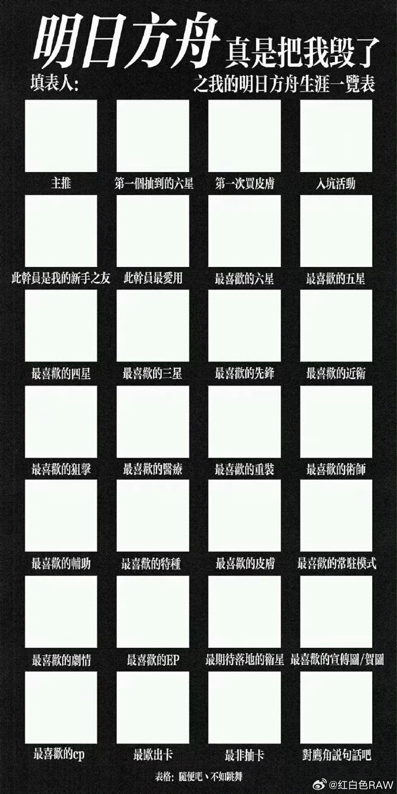
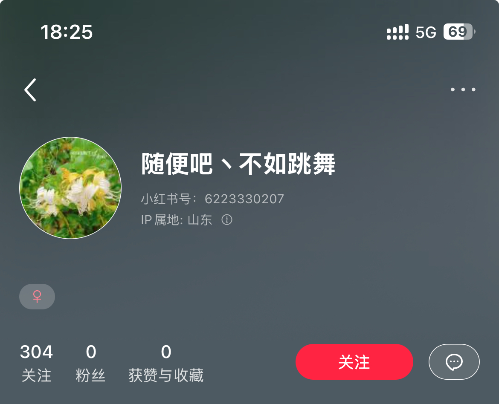

[中文](./README.md) | [English](./README_EN.md)

# Arknights Career Generator

An online tool for recording and sharing your Arknights journey. Choose operators, outfits, events, and medals, add your preferences, and generate a career page that you can export as a PNG image.

[Use online](https://arknights.shuaxinjs.cn/)

## Features

- Record your main operator, first six-star operator, early-game companion, and favorites by rarity, class, and gender.
- Choose your first purchased outfit, favorite outfit, first event, favorite story, and favorite medal set.
- Add your in-game name, permanent game mode, EP, and most anticipated character. Choose a profile avatar from game avatars, operator portraits, or medals.
- Search selections, track completion, preview example data, and return to editing.
- Career form data is saved in the current browser's `localStorage`, so you can continue after refreshing.
- Chinese, English, and Japanese interfaces, with localized operator and outfit names and Chinese fallbacks for missing translations.
- Export the complete result area as a PNG, with page transitions, interaction animations, and support for reduced motion preferences.

## User Guide

### Editor `/`

1. Select or fill in at least one field, then click **Generate** to open your result page.
2. **Preview Example** loads example data into the career form and opens the result page. **It overwrites your previously saved form data.**
3. Use the language button at the top of the page to switch languages or visit related resources in the drawer.

### Result Page `/result`

- **Edit** returns to the editor and keeps your form data.
- **Export Result** downloads `Arknights.png`. The image covers the entire result container, including action buttons, regardless of scroll position, at three times the rendered resolution.
- A standalone browser is recommended for exporting. Embedded browsers, Safari, and cross-origin image restrictions may affect downloads or rendering; results can differ across environments.

The exporter detects experimental HTML-in-Canvas support first, then falls back to `dom-to-image → SVG → Canvas` if unavailable or unsuccessful. See the [export notes](./src/utils/screenshot.md) (Chinese) for implementation details.

## Tech Stack

- **Frontend**: React 19, TypeScript, React Router 7.
- **Build and styling**: Rsbuild, Tailwind CSS 3, and React/CSS UI components maintained in this repository.
- **Interaction and state**: Framer Motion, ahooks, next-themes.
- **Localization**: i18next, react-i18next.
- **Image export**: dom-to-image, Canvas, file-saver.
- **Data maintenance**: Puppeteer, tsx, and the ArknightsGamedata Git submodule.

## Local Development

Install Node.js (an LTS release is recommended), Git, and pnpm 10.26.0, as specified in `package.json`.

```bash
git clone https://github.com/SHUAXINDIARY/Arknights.git
cd Arknights
pnpm install
pnpm dev
```

Open the local URL printed in the terminal. The frontend uses data already committed to the repository. Starting or building it does not require scraping PRTS or initializing the game data submodule; the submodule is needed for data update scripts.

### Commands

| Command | Purpose |
| --- | --- |
| `pnpm dev` | Start the development server |
| `pnpm build` | Produce a production build in `dist/` |
| `pnpm preview` | Preview an existing production build locally |
| `pnpm lint` | Run ESLint |
| `pnpm init:submodule` | Initialize and check out the game data submodule |
| `pnpm update:submodule` | Update the submodule to its latest remote commit |
| `pnpm update:prts` | Scrape PRTS and update generated data |
| `pnpm update:international` | Add operator and outfit translations from the submodule |
| `pnpm auto` | Run PRTS scraping, submodule update, and localization update, in that order |

### Build and Deployment

```bash
pnpm build
pnpm preview
```

Deploy `dist/` to a static hosting service such as Cloudflare. The application uses browser routing, so the host must serve `index.html` for frontend routes such as `/result` to support direct visits and refreshes.

The repository's [GitHub Actions workflow](./.github/workflows/deploy.yml) updates data; it contains no website deployment steps.

## Data Maintenance

### Sources

- [PRTS Wiki](https://prts.wiki/w/%E9%A6%96%E9%A1%B5): scraped operator, outfit, avatar, event, medal, and medal set data.
- [ArknightsGamedata](https://github.com/ArknightsAssets/ArknightsGamedata): included as the `scripts/ArknightsGamedata` submodule, providing Chinese, English, and Japanese game data and translations.
- [Bilibili Arknights Wiki](https://wiki.biligame.com/arknights/%E9%A6%96%E9%A1%B5): one of the project's original reference sources.

`src/data/` contains baseline data. Individual data modules merge and deduplicate it with `AutoGenerateData.ts` for use in the frontend.

### Manual Updates

Run these commands from the repository root, with access to the data sources and Chrome installed for Puppeteer:

```bash
pnpm init:submodule
pnpm exec puppeteer browsers install chrome
pnpm auto
```

Once the submodule is initialized, you can run `pnpm update:prts`, `pnpm update:submodule`, or `pnpm update:international` separately as needed. The PRTS script also reads the submodule to map translations, so it requires initialization even when run separately.

Update scripts rewrite `src/data/AutoGenerateData.ts`, and updating the submodule may change its commit pointer. Review the diff before committing. Newly scraped PRTS records are placed before existing generated records, with duplicates removed.

The [data update workflow](./.github/workflows/deploy.yml) is scheduled to trigger daily at 02:00 UTC (10:00 China Standard Time) and can also be triggered manually. It installs the browser, runs `auto`, and commits and pushes changes.

### Operator Scraper Verification

The repository includes regression tests using local pages to verify delayed loading, pagination, and errors for missing pages. A Puppeteer browser is required:

```bash
pnpm exec tsx --test scripts/prtsOperators.test.ts
```

To verify the current PRTS site, enable the optional live test, which does not write data files:

```bash
PRTS_LIVE_TEST=1 pnpm exec tsx --test scripts/prtsOperators.test.ts
```

## Project Structure

```text
src/
  pages/Home/           Career editor
  pages/Result/         Result display and export
  components/          Local UI, search selectors, image and form components
  data/                Baseline, generated, and example data
  hooks/               Local storage and scroll hooks
  utils/I18n/          Chinese, English, and Japanese interface strings
  utils/screenshot.ts  PNG export implementation
scripts/
  getDataFromPrts.ts    PRTS scraping entry point
  prtsOperators.ts     Paginated operator extraction
  prtsOperators.test.ts Operator scraper tests
  filterData.ts        Localization mapping
  ArknightsGamedata/   Game data Git submodule (requires initialization)
.github/workflows/
  deploy.yml           Scheduled data update workflow
```

## Inspiration and Credits

The project began after seeing a career sheet shared on Weibo by [红白色 RAW](https://weibo.com/u/2940601822). Online input and image generation make it easier for more players to participate.



The original sheet author's ID appears at the bottom of the reference image. Their Xiaohongshu account is shown below. Developed by [SHUAXINDIARY](https://github.com/SHUAXINDIARY), with thanks to the original creator and the reference sites.



## Disclaimer

This is an unofficial fan tool. Company names, trademarks, and products belong to their respective owners and are used for identification. Game images, animations, audio, and original text are used to present game information; their copyrights belong to Arknights / Shanghai Hypergryph Network Technology Co., Ltd. and the relevant rights holders.
